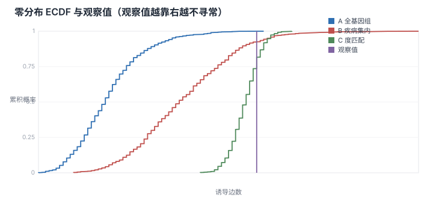

# 阴性对照检验报告

- 观察集：23 个交集基因；PPI 网络 281 节点 / 3453 边（阈值 ≥0.40）
- 统计量：观察集诱导边数（obs）；B/D 组另给经验 P 与 Z

| 零模型 | 观察值 | 零均值 | 零95分位 | 经验P | Z | 迭代 |
|---|---|---|---|---|---|---|
| A_全基因组 | 64 | 22.023 | 40 | 0.0020 | 4.24 | 1000 |
| B_疾病集内 | 64 | 43.248 | 68 | 0.0779 | 1.46 | 1000 |
| C_度匹配 | 64 | 60.763 | 68 | 0.2657 | 0.77 | 1000 |

## 零模型自校准（先证明你的对照是有效的）

| 指标 | 值 | 判定 |
|---|---|---|
| C 组平均 \|Δdeg\| | 0.00 | 通过 |
| C 组精确匹配比例 | 1.00 | 通过 |
| C 组度分布 KS 距离 | 0.000 | 通过 |

> C 组零模型的度分布与观察集匹配（KS≤0.10），其经验 P 值可作为「控制度之后是否仍紧密」的依据。

## 判读

- **B 组不显著（P=0.0779）**：交集基因的互联程度与「从疾病基因里随机抽」无异。此时**不得**用「紧密互联的核心模块」描述结果，机制推断强度必须下调，建议改以富集与实验证据为主线。
- **C 组不显著（P=0.2657）**：观察集的紧密性可由「度分布」解释，即交集偏向高连接度基因。这是 PPI 类研究最典型的混杂，必须在局限性中写明。

## 统一裁决（三套对照不一致时以此为准）

**两套对照均不显著**：不支持「紧密互联」的表述。应把结论重心放在富集与外部证据上，并在局限性中写明网络层面无信号。

| 对照 | 问题 | 结论方向 |
|---|---|---|
| A 全基因组 | 比随机基因更紧密？ | 是 |
| B 疾病集内 | 比随机疾病基因更紧密？ | 否 |
| C 度匹配 | 控制度之后仍更紧密？ | 否 |

> 优先级：B > C > A。A 几乎总会显著（任何疾病相关基因都比随机基因更互联），单报 A 等于没有对照。

## 必须写进论文的一句话

> 为排除网络拓扑与研究偏倚造成的假阳性，本研究以 1000 次随机模拟构建零模型：A 全基因组随机、B 疾病靶点集内随机、C 度匹配随机、D 成分-靶点标签置换；经验 P 值按 (1+#{null≥obs})/(1+B) 计算。

## 零分布 ECDF

竖线为观察值。若它落在三条曲线的右端（累积概率≈1），说明观察到的连接密度在三种零模型下都不寻常；若只落在 A 的右端而不在 C 的右端，说明差异主要来自度分布。

